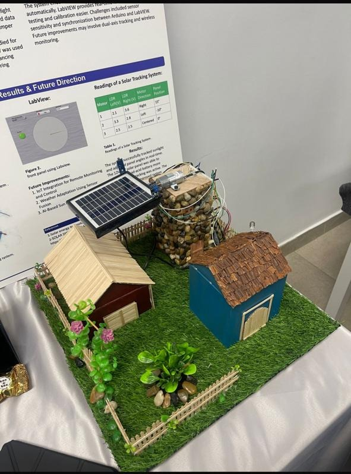
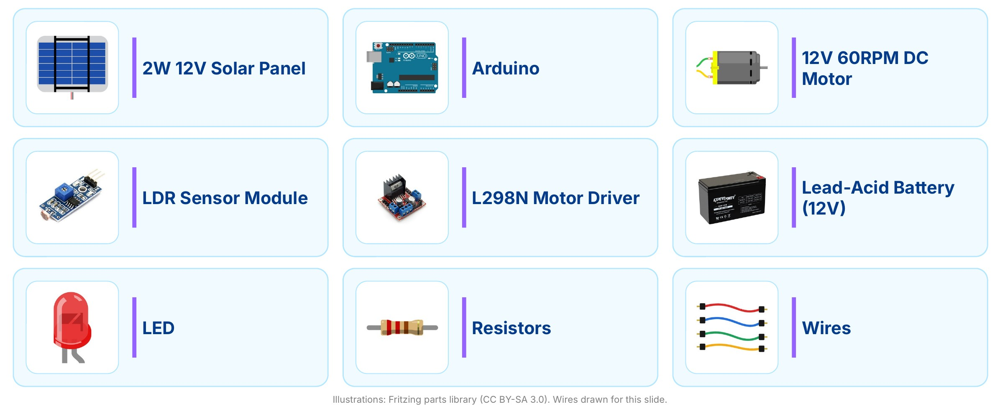
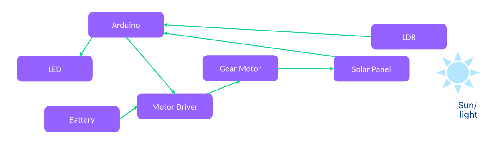
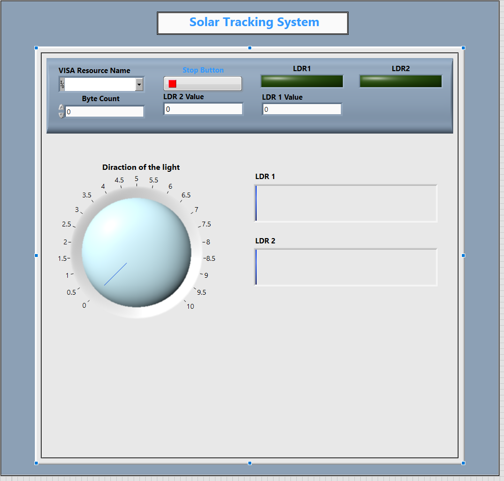
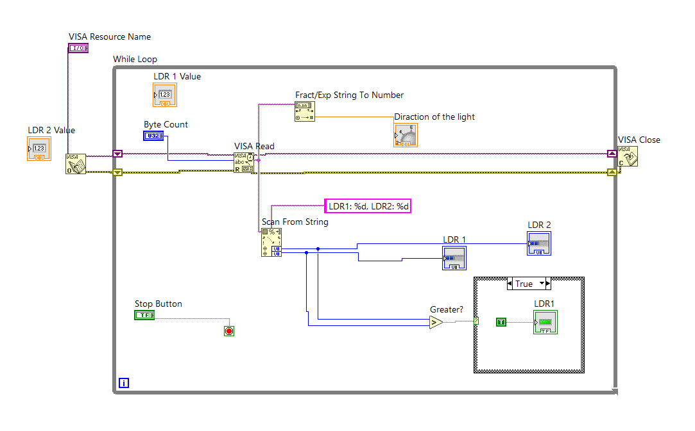
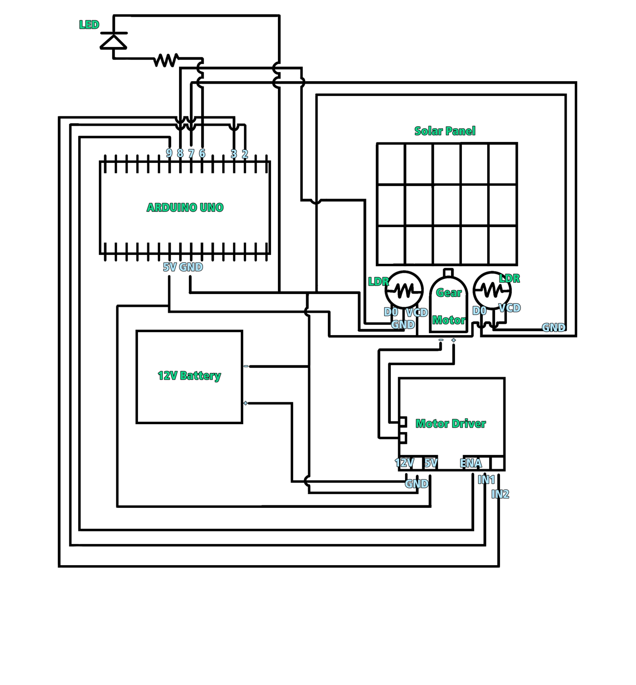
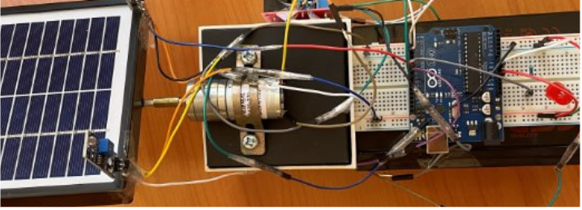

# Solar Tracking System

CSE471 (Microcontroller Interfacing and Data Acquisition) course project at Yanbu Industrial College. An Arduino-based solar panel tracker that uses LDR light sensors, with LabVIEW for real-time monitoring.

**Team:** Wejdan Aljohani, Raniya Alsulaimani, Rama Ayman



## Overview

Two LDR sensors detect which side has more light, and the Arduino turns a DC motor through an L298N driver toward it. LabVIEW reads the sensor values over serial (VISA) and monitors them in real time.

## Components



Component illustrations are from the Fritzing parts library (CC BY-SA 3.0).

## System block diagram



## Working principle

1. The two LDR sensors measure the light on each side
2. The Arduino compares the readings. If one is brighter and above the threshold, it turns the motor toward that side and lights an indicator LED. If neither is bright enough, the motor stops and the LED turns off.
3. The Arduino sends both LDR values over serial, and LabVIEW reads and displays them
4. The battery powers the motor and the controller

## LabVIEW program

LabVIEW reads the two LDR values from the Arduino over serial using VISA and shows them live on two bar indicators and a light direction dial. It compares the two values and lights the LDR 1 indicator when LDR 1 is the greater one. A stop button ends the program.

**Front panel**



**Block diagram**



## Circuit design



- The solar panel connects to the battery
- The battery powers the motor through the L298N driver
- All components are powered from the 12V supply

## Hardware



## Code

Full sketch: [arduino/solar_tracking_system/solar_tracking_system.ino](arduino/solar_tracking_system/solar_tracking_system.ino)

Main decision logic:

```cpp
// If LDR1 detects higher light intensity
if (data1 > data2 && data1 > lightThreshold) {
  // Rotate motor to the left
  digitalWrite(in1, LOW);
  digitalWrite(in2, HIGH);
  digitalWrite(ledPin, HIGH);   // Turn on LED to indicate action
} 
// If LDR2 detects higher light intensity
else if (data2 > data1 && data2 > lightThreshold) {
  // Rotate motor to the right
  digitalWrite(in1, HIGH);
  digitalWrite(in2, LOW);
  digitalWrite(ledPin, HIGH);   // Turn on LED to indicate action
}
else {
  // If neither LDR detects sufficient light, stop the motor
  digitalWrite(in1, HIGH);
  digitalWrite(in2, HIGH);  // Stop the motor
  digitalWrite(ledPin, LOW);  // Turn off LED when no high light is detected
}
```

## Project files

- [Arduino code](arduino/solar_tracking_system/solar_tracking_system.ino)
- [LabVIEW program (.vi)](labview/Solar_Tracking_System.vi) (needs LabVIEW to open)
- [Presentation (PDF)](docs/Solar_Tracking_System_Presentation.pdf)

## Skills shown

- Microcontroller interfacing and data acquisition
- Arduino programming (C++)
- LabVIEW (front panel and block diagram)
- Serial communication (VISA)
- Sensor interfacing (LDR)
- Motor control (L298N driver, PWM speed)
- Circuit design
- Hardware testing
- Teamwork
- Technical documentation
